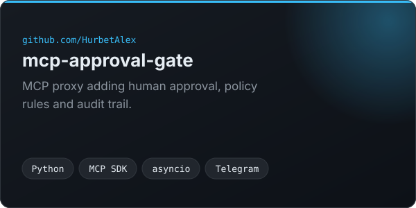
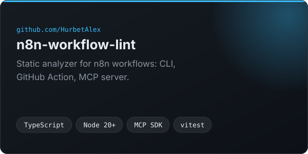

  

I build agentic systems and the Python backends around them. My agents ask before they act, write an audit log and stop at a cost budget. I take projects from prototype to something that runs on a server, with tests.

Based in Antalya, Türkiye · Ukraine. Open to remote work and relocation.

[Email](mailto:alexhurbet@icloud.com) · [LinkedIn](https://www.linkedin.com/in/%3Chandle%3E) · [CV](https://github.com/HurbetAlex/HurbetAlex/blob/main/CV.pdf)

## Featured projects

<table>
  <tr>
    <td width="50%"></td>
    <td width="50%"></td>
  </tr>
</table>

## What I work with

  

  
  
  
  
  
  
  
  
  
  

## How I build

- **A human approves risky agent actions.** Tool calls go through a gate with policy rules, and every decision lands in an audit log.
- **Secrets stay out of argv and logs.** They come from the environment or a secret store, never from a command line.
- **Tests come first.** I write the failing test, then the code, and CI runs the same suite I run locally.
- **I add logging and cost tracking early.** When an agent misbehaves, I want the trace and the token bill in front of me.
- **Steps stay small.** Each change gets checked before I start the next one.

## Get in touch

I'm looking for AI Engineer, LLM Engineer and Python backend roles. Write to [alexhurbet@icloud.com](mailto:alexhurbet@icloud.com).
